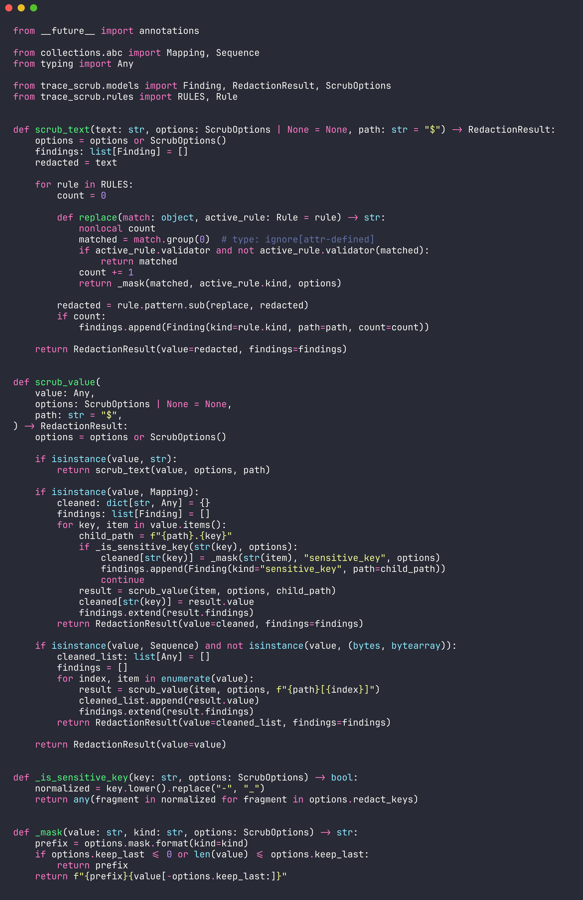
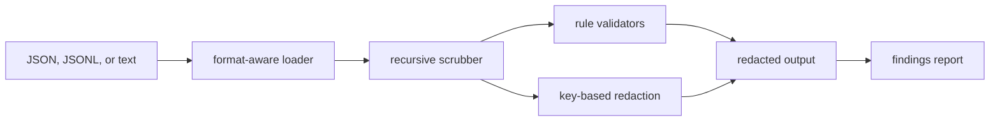

# trace-scrub



`trace-scrub` is a small CLI and Python library for redacting sensitive values from LLM traces,
prompt logs, JSON payloads, and JSONL evaluation datasets before they are shared, committed, or
used in bug reports.

LLM applications often collect realistic prompts, tool outputs, request metadata, and replay
fixtures. Those files are useful for debugging, but they can quietly contain emails, API keys,
tokens, phone numbers, cards, or IP addresses. `trace-scrub` keeps the original structure intact
while replacing risky values with readable redaction markers.

## What it catches

| Category | Examples |
| --- | --- |
| Secrets | OpenAI-style keys, AWS access keys, JWTs |
| Personal data | email addresses, phone numbers, credit cards with Luhn validation |
| Network data | IPv4 addresses |
| Sensitive fields | keys containing `token`, `secret`, `password`, `authorization`, `cookie`, and similar names |

## Install

```bash
git clone https://github.com/mertefekurt/trace-scrub.git
cd trace-scrub
python -m venv .venv
source .venv/bin/activate
python -m pip install -e ".[dev]"
```

## Usage

Scrub a JSONL trace and write both the cleaned file and a report:

```bash
trace-scrub examples/chat-trace.jsonl \
  --output cleaned.jsonl \
  --report report.txt
```

Fail a CI step if anything sensitive is detected:

```bash
trace-scrub examples/chat-trace.jsonl --fail-on-findings
```

Keep the final four characters of redacted values when you need debugging hints:

```bash
trace-scrub examples/chat-trace.jsonl --keep-last 4
```

Use it from Python:

```python
from trace_scrub import scrub_value

result = scrub_value({
    "messages": [{"role": "user", "content": "email me at ada@example.com"}],
    "api_key": "sk-example000000000000000000000000",
})

print(result.value)
print(result.summary())
```

## How it works



The scrubber uses deterministic local rules only. It does not send traces to an external model or
service. JSON and JSONL inputs are parsed and emitted as structured data, so downstream tests and
replay tools can keep using the cleaned files.

## Project layout

```text
src/trace_scrub/
  cli.py       command-line interface
  io.py        file loading, JSONL handling, and report rendering
  models.py    public dataclasses and options
  rules.py     redaction patterns and validators
  scrubber.py  recursive text and structure scrubbing
tests/         behavior and CLI tests
examples/      sample LLM trace fixture
```

## Tests and linting

```bash
ruff check .
pytest
```

The test suite covers text redaction, sensitive key handling, nested trace preservation, credit-card
validation, CLI output, and CI failure behavior.

## License

MIT
