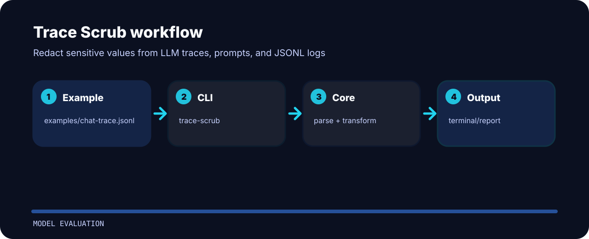

# Trace Scrub

Redact sensitive values from LLM traces, prompts, and JSONL logs. The repo is kept small on purpose: clone it, run the sample, inspect the output, then adapt the idea.


## Visual route



## First run

```bash
git clone https://github.com/mertefekurt/trace-scrub.git
cd trace-scrub
python -m pip install -e ".[dev]"
trace-scrub examples/chat-trace.jsonl
```

## File map

```text
.github/        CI workflow
examples/       sample inputs
src/            package source
tests/          test coverage
.gitignore      project file
```
